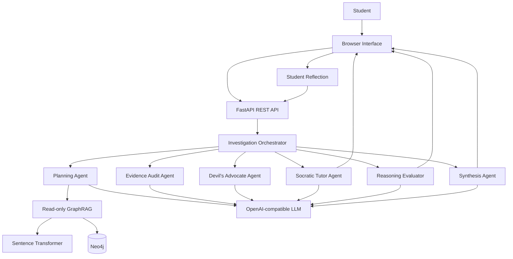
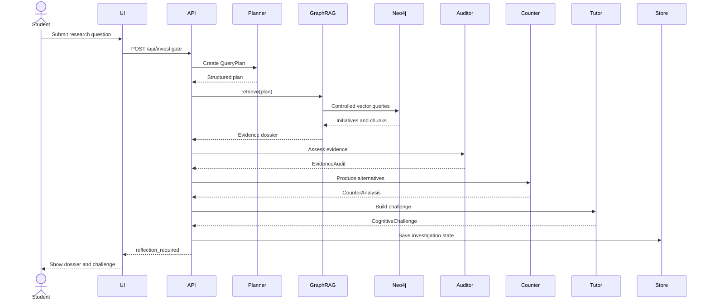
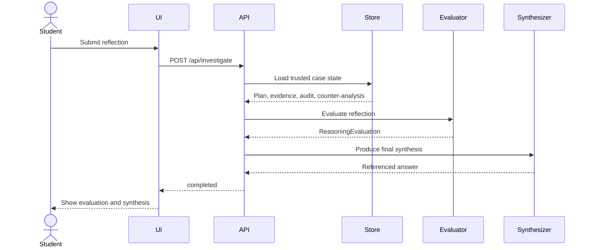

# System Architecture

## Purpose

ÁgoraMX combines a read-only Neo4j GraphRAG layer with specialized language-model agents to create a guided civic research experience.

The architecture separates:

- Retrieval
- Evidence normalization
- Evidence quality assessment
- Pedagogical interaction
- Reasoning evaluation
- Final synthesis

This separation makes it easier to inspect where a conclusion came from and which component is responsible for each decision.

---

## High-level architecture



---

## Main components

### Browser interface

The static frontend manages the five visible stages:

1. Question
2. Plan
3. Evidence dossier
4. Reflection
5. Evaluation and synthesis

It also renders a graph snapshot derived from recovered evidence.

The frontend does not query Neo4j directly.

### FastAPI application

`app/main.py`:

- Starts and closes shared application resources.
- Initializes Neo4j and the LLM client.
- Builds the investigation orchestrator.
- Serves static files.
- Exposes the REST API.
- Converts application exceptions into HTTP responses.

### Investigation orchestrator

`app/orchestrator.py` coordinates the workflow.

It supports two operations:

- Open an investigation.
- Complete an investigation after receiving the student's reflection.

The orchestrator, rather than the frontend, determines the order of the agents.

### LLM client

`app/llm.py` calls an OpenAI-compatible chat completions endpoint.

It supports:

- Plain-text completions
- Pydantic-validated structured completions

Structured agents receive a JSON Schema and are instructed to return a JSON object matching that schema.

### Read-only GraphRAG

`app/graph.py`:

- Generates the query embedding.
- Executes predefined vector queries.
- Expands initiative relationships.
- Normalizes graph records into `EvidenceItem` objects.
- Builds a frontend-oriented graph snapshot.
- Reports available and unavailable graph capabilities.

### Session store

The MVP uses `InMemoryCaseStore`.

It stores:

- Session identifier
- Original question
- Query plan
- Evidence dossier
- Evidence audit
- Counter-analysis
- Creation time

This prevents the second request from replacing the original evidence dossier with arbitrary client-provided evidence.

---

## First-stage sequence



---

## Second-stage sequence



---

## Trust boundaries

### Trusted application-controlled data

- Cypher templates
- Neo4j connection settings
- Stored evidence dossier
- Pydantic schemas
- Shared agent policy
- Retrieval limits

### Untrusted or partially trusted data

- Student questions
- Student reflections
- Neo4j document content
- LLM output
- Source URLs
- External document text

LLM output must be considered generated data even after schema validation. Schema validation confirms shape, not factual correctness.

---

## Synchronous work inside async requests

The Neo4j driver calls and `SentenceTransformer.encode()` are synchronous.

The orchestrator therefore runs retrieval using:

```python
await asyncio.to_thread(
    self.graph.retrieve,
    plan,
)
```

For a larger deployment, use one or more of:

- A dedicated retrieval worker pool
- An async Neo4j driver
- A separate embedding service
- Cached query embeddings
- Bounded concurrency

---

## Read-only strategy

Read-only behavior is enforced at multiple layers:

1. The LLM cannot submit Cypher.
2. The application contains predefined queries.
3. Neo4j sessions use `READ` access mode.
4. The REST API exposes no general-purpose graph query route.
5. Production credentials should have database-level read-only permissions.

Defense in depth is necessary. Session access mode alone should not be considered a complete authorization policy.
