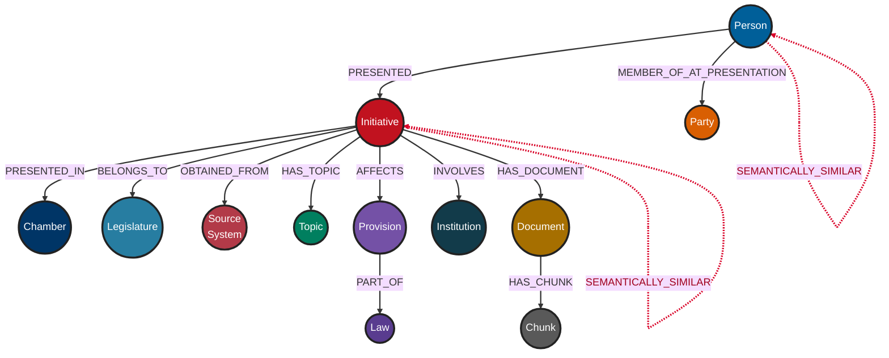

# Knowledge Graph Schema

## Overview

The ÁgoraMX knowledge graph represents legislative initiatives and the entities needed to investigate their content and institutional context.

The graph is intended to answer questions about documentary and structural relationships. It is not, by itself, a complete representation of political conduct.

---

## Schema diagram


### Relationship types

- **Solid arrows** represent structural relationships.
- **Dashed red arrows** represent semantic similarity between entities of the same type.

---

## Node labels

### `Initiative`

Represents a legislative initiative.

| Property | Type | Description |
|---|---|---|
| `sil_id` | String | Unique initiative identifier |
| `title` | String | Initiative title |
| `summary` | String | Summary or abstract |
| `presentation_date` | Date or String | Presentation date |
| `publication_date` | Date or String | Publication date |
| `status` | String | Legislative status |
| `source_url` | String | Original source URL |
| `embedding_text` | String | Text used to generate the embedding |
| `embedding` | List of Float | Vector representation |
| `embedding_model` | String | Embedding model identifier |
| `content_hash` | String | Content integrity or change-detection hash |
| `updated_at` | DateTime | Last update timestamp |

Recommended unique key:

```text
sil_id
```

### `Person`

Represents a person who presented one or more initiatives.

| Property | Type | Description |
|---|---|---|
| `person_id` | String | Unique person identifier |
| `name` | String | Display name |
| `embedding` | List of Float | Aggregate vector representation |
| `initiative_count` | Integer | Initiatives used in the aggregate |
| `embedding_model` | String | Embedding model |
| `embedding_method` | String | Aggregation method |

A person embedding summarizes initiative-related content. It must not be interpreted as a complete representation of the person's beliefs or conduct.

### `Party`

Represents a political party.

| Property | Type | Description |
|---|---|---|
| `party_id` | String | Unique party identifier |
| `name` | String | Official name |
| `abbreviation` | String | Short name |

### `Topic`

Represents a topic assigned to an initiative.

| Property | Type | Description |
|---|---|---|
| `topic_id` | String | Unique topic identifier |
| `name` | String | Topic name |
| `level` | String | Topic hierarchy level or category |

### `Law`

Represents a law.

| Property | Type | Description |
|---|---|---|
| `law_id` | String | Unique law identifier |
| `name` | String | Law name |

### `Provision`

Represents a specific legal provision.

| Property | Type | Description |
|---|---|---|
| `provision_id` | String | Unique provision identifier |
| `article` | String | Article number or label |
| `fraction` | String | Fraction, subsection, or equivalent |

### `Institution`

Represents an institution involved in an initiative.

| Property | Type | Description |
|---|---|---|
| `institution_id` | String | Unique institution identifier |
| `name` | String | Institution name |
| `abbreviation` | String | Institution abbreviation |

### `Document`

Represents a document associated with an initiative.

| Property | Type | Description |
|---|---|---|
| `document_id` | String | Unique document identifier |
| `url` | String | Source URL |
| `local_path` | String | Local file path |
| `filename` | String | File name |
| `exists_locally` | Boolean | Whether a local copy exists |
| `chunk_count` | Integer | Number of document chunks |

Local paths should not be returned to untrusted clients.

### `Chunk`

Represents a fragment extracted from a document.

| Property | Type | Description |
|---|---|---|
| `chunk_id` | String | Unique chunk identifier |
| `text` | String | Fragment text |
| `text_hash` | String | Hash of normalized text |
| `page` | Integer | Source page |
| `chunk_index` | Integer | Position within the document |
| `character_count` | Integer | Character count |
| `embedding` | List of Float | Vector representation |
| `embedding_model` | String | Embedding model identifier |

### `Chamber`

Represents the legislative chamber in which an initiative was presented.

| Property | Type | Description |
|---|---|---|
| `name` | String | Unique chamber name |

### `Legislature`

Represents the legislature to which an initiative belongs.

| Property | Type | Description |
|---|---|---|
| `name` | String | Unique legislature name |

### `SourceSystem`

Represents the system from which information was obtained.

| Property | Type | Description |
|---|---|---|
| `name` | String | Unique source system name |

---

## Relationships

### `PRESENTED`

```cypher
(Person)-[:PRESENTED]->(Initiative)
```

Indicates that a person is recorded as a presenter of an initiative.

Possible relationship properties may include:

- `role`
- `source`
- `observed_at`

Presenting an initiative does not establish how the person later voted.

### `MEMBER_OF_AT_PRESENTATION`

```cypher
(Person)-[:MEMBER_OF_AT_PRESENTATION]->(Party)
```

Represents political affiliation at the time an initiative was presented.

The current implementation associates the membership relationship with an initiative through:

```text
membership.initiative_id
```

This property is important because affiliations may change over time.

### `PRESENTED_IN`

```cypher
(Initiative)-[:PRESENTED_IN]->(Chamber)
```

Identifies the legislative chamber.

### `BELONGS_TO`

```cypher
(Initiative)-[:BELONGS_TO]->(Legislature)
```

Identifies the corresponding legislature.

### `OBTAINED_FROM`

```cypher
(Initiative)-[:OBTAINED_FROM]->(SourceSystem)
```

Records data provenance.

### `HAS_TOPIC`

```cypher
(Initiative)-[:HAS_TOPIC]->(Topic)
```

Associates an initiative with one or more topics.

A topic can be manually assigned, imported, or computationally derived. Documentation should state which method is used.

### `AFFECTS`

```cypher
(Initiative)-[:AFFECTS]->(Provision)
```

Indicates that an initiative proposes to modify or otherwise affect a provision.

The relationship may include:

```text
operation
```

Examples include:

- Add
- Amend
- Repeal
- Replace

### `PART_OF`

```cypher
(Provision)-[:PART_OF]->(Law)
```

Associates a provision with its parent law.

### `INVOLVES`

```cypher
(Initiative)-[:INVOLVES]->(Institution)
```

Identifies institutions mentioned or affected by an initiative.

The exact meaning of “involves” should be defined by the ingestion process.

### `HAS_DOCUMENT`

```cypher
(Initiative)-[:HAS_DOCUMENT]->(Document)
```

Associates an initiative with a document.

### `HAS_CHUNK`

```cypher
(Document)-[:HAS_CHUNK]->(Chunk)
```

Associates a document with its extracted fragments.

### `SEMANTICALLY_SIMILAR`

```cypher
(Initiative)-[:SEMANTICALLY_SIMILAR]->(Initiative)
(Person)-[:SEMANTICALLY_SIMILAR]->(Person)
```

Represents computed vector similarity.

Recommended relationship metadata:

| Property | Description |
|---|---|
| `score` | Similarity score |
| `model` | Embedding model |
| `method` | Similarity method |
| `created_at` | Computation timestamp |

This relationship is a retrieval or exploration signal. It does not prove substantive agreement or coordination.

---

## Expected vector indexes

### Initiative index

Expected name:

```text
initiative_embedding
```

Conceptual definition:

```cypher
CREATE VECTOR INDEX initiative_embedding IF NOT EXISTS
FOR (i:Initiative)
ON i.embedding
OPTIONS {
  indexConfig: {
    `vector.dimensions`: 384,
    `vector.similarity_function`: 'cosine'
  }
};
```

### Chunk index

Expected name:

```text
chunk_embedding
```

Conceptual definition:

```cypher
CREATE VECTOR INDEX chunk_embedding IF NOT EXISTS
FOR (c:Chunk)
ON c.embedding
OPTIONS {
  indexConfig: {
    `vector.dimensions`: 384,
    `vector.similarity_function`: 'cosine'
  }
};
```

The dimensions shown above correspond to the expected MiniLM model configuration. Confirm the actual dimensions in the database before creating or querying the indexes.

The application itself does not create or modify these indexes.

---
